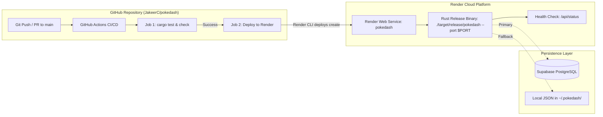

# PokéDash Advance — Deployment Guide 🚀

This document covers the end-to-end deployment setup, architecture, and step-by-step instructions for hosting **PokéDash Advance** on **Render** using **GitHub Actions CI/CD** and **Infrastructure-as-Code (Render Blueprints)**.

---

## 🌐 Live Service Information

- **Service Name**: `pokedash`
- **Primary URL**: [https://pokedash-e79f.onrender.com](https://pokedash-e79f.onrender.com)
- **Health Check Endpoint**: [https://pokedash-e79f.onrender.com/api/status](https://pokedash-e79f.onrender.com/api/status)
- **Render Dashboard**: [https://dashboard.render.com/web/srv-dbnkb3mc6qcc73e4qfs0](https://dashboard.render.com/web/srv-dbnkb3mc6qcc73e4qfs0)
- **Render Service ID**: `srv-dbnkb3mc6qcc73e4qfs0`
- **Render Region**: `oregon` (US West)
- **Instance Plan**: `free` (512 MB RAM, 0.1 CPU)

---

## 🏗️ Architecture Overview



1. **Auto-Deploy on Push is Disabled**: Direct deployment on commit is turned off (`autoDeployTrigger: off` in `render.yaml`) so that untracked or untested commits do not deploy directly.
2. **Automated Testing Gate**: GitHub Actions compiles and runs all test suites (`cargo check`, `cargo test`) before triggering any deployment.
3. **Render CLI Deployment**: Uses Render's official CLI with `--wait` to ensure the runner monitors deploy status to completion and reports errors if the build or health check fails.
4. **Dynamic Port Binding**: Render automatically injects `PORT=10000`. PokéDash reads `$PORT` from the environment dynamically while binding to `0.0.0.0`.
5. **Fail-Safe Persistence**: Automatically connects to Supabase if credentials are provided in Render environment variables; falls back to disk storage (`$HOME/.pokedash/`) if offline or unconfigured.

---

## 📋 Deployment Methods

### Method 1: Automated Deployment via GitHub Actions (Recommended)

The CI/CD pipeline is defined in [`.github/workflows/deploy.yml`](.github/workflows/deploy.yml).

#### Workflow Behavior
- **Pull Requests to `main`**: Runs the `test` job (`cargo check`, `cargo test`, dependency caching) to validate changes before merging.
- **Pushes / Merges to `main`**: Runs the `test` job, and upon success, automatically runs the `deploy` job.
- **Manual Trigger**: Can be manually triggered from the **Actions** tab on GitHub (`workflow_dispatch`).

#### Step-by-Step GitHub Setup

1. Open your repository on GitHub: **[JakeerC/pokedash](https://github.com/JakeerC/pokedash)**
2. Navigate to **Settings > Secrets and variables > Actions**.
3. Under **Repository secrets**, click **New repository secret**.
4. Add the following secrets:

| Secret Name | Required? | Description & How to Get |
|---|---|---|
| `RENDER_API_KEY` | **Required** | Your Render API key from [Render Account Settings > API Keys](https://dashboard.render.com/u/settings#api-keys). |
| `RENDER_SERVICE_ID` | Optional | `srv-dbnkb3mc6qcc73e4qfs0` (workflow automatically defaults to this if omitted). |
| `RENDER_DEPLOY_HOOK_URL` | Optional | Deploy Hook URL from **Render Dashboard > pokedash > Settings > Deploy Hook** (used as an automated fallback if no API key is set). |

5. Once secrets are added, any merge or push to `main` will automatically build, test, and deploy.

---

### Method 2: Infrastructure-as-Code via Render Blueprint

The infrastructure configuration is codified in [`render.yaml`](render.yaml):

```yaml
services:
  - type: web
    name: pokedash
    runtime: rust
    plan: free
    region: oregon
    branch: main
    autoDeployTrigger: off
    buildCommand: cargo build --release
    startCommand: ./target/release/pokedash --port $PORT
    healthCheckPath: /api/status
    envVars:
      - key: SUPABASE_URL
        sync: false
      - key: SUPABASE_KEY
        sync: false
```

#### Deploying with Blueprint Deeplink:
If you ever need to recreate or clone the service infrastructure in a new workspace or region:

1. Open the [Render Blueprint One-Click Deploy](https://dashboard.render.com/blueprint/new?repo=https://github.com/JakeerC/pokedash).
2. Authorize Render access to the repository if prompted.
3. Supply your `SUPABASE_URL` and `SUPABASE_KEY` when prompted (or leave blank for offline disk storage).
4. Click **Apply**.

---

### Method 3: Deploying via Render MCP & AI Agents

If you are using Antigravity, Cursor, or Claude Code with Render MCP connected:

#### Available MCP Operations:
```json
// List existing services
call_mcp_tool("render", "list_services", { "workspaceId": "tea-d99rmqbeo5us7390r590" })

// Check deploy history and status
call_mcp_tool("render", "list_deploys", { "serviceId": "srv-dbnkb3mc6qcc73e4qfs0" })

// View live runtime or build logs
call_mcp_tool("render", "list_logs", { "resource": ["srv-dbnkb3mc6qcc73e4qfs0"], "direction": "backward", "limit": 50 })

// Manually trigger a new deploy
call_mcp_tool("render", "trigger_deploy", { "serviceId": "srv-dbnkb3mc6qcc73e4qfs0" })
```

#### MCP Server Configuration (`~/.gemini/config/mcp_config.json`):
```json
{
  "mcpServers": {
    "render": {
      "url": "https://mcp.render.com/mcp",
      "headers": {
        "Authorization": "Bearer <YOUR_RENDER_API_KEY>"
      }
    }
  }
}
```

---

## 🔑 Environment Variables Reference

| Variable | Environment | Description | Default |
|---|---|---|---|
| `PORT` | Render / Container | The HTTP port the web server listens on. Render provides this automatically. | `10000` on Render (`8080` local) |
| `HOST` | Local / Render | IP interface to bind to. Must be `0.0.0.0` for containerized environments. | `0.0.0.0` |
| `SUPABASE_URL` | Render / `.env` | HTTPS URL of the Supabase PostgreSQL instance. | Optional (local fallback) |
| `SUPABASE_KEY` | Render / `.env` | Supabase anonymous API key for PostgREST calls. | Optional (local fallback) |
| `USER` / `USERNAME` | System / Render | Sets the trainer account name in the game. | `Trainer` |

---

## 🔍 Verification & Health Checks

After a deployment completes:

1. **Verify Health Endpoint**:
   ```bash
   curl -s https://pokedash-e79f.onrender.com/api/status | jq .
   ```
   Expected response:
   ```json
   {
     "status": "online",
     "version": "0.2.0",
     "total_pokemon": 1025,
     "player_level": 1
   }
   ```

2. **Verify Web Interface**:
   Visit [https://pokedash-e79f.onrender.com](https://pokedash-e79f.onrender.com) in any browser. The retro GBA screen, sprite assets, and chiptune audio should load immediately without build errors.

---

## 🛠️ Troubleshooting

### 1. Build Timeouts
- **Cause**: Rust release compilation (`cargo build --release`) compiles dependencies from source on the free tier CPU.
- **Resolution**: Normal build takes ~1m 30s. Render allows up to 120 minutes for builds, so timeouts should not occur.

### 2. Free Tier Spin Down (Cold Starts)
- **Symptom**: First request after 15 minutes of inactivity takes 20–30 seconds.
- **Explanation**: Render Free web services spin down instances when idle to conserve compute hours.
- **Resolution**: Upgrade to a Render Starter plan ($7/mo) for 24/7 always-on service if instant wakeups are required.

### 3. Port Binding Issues
- **Symptom**: `No open ports detected, continuing to scan...` in logs.
- **Resolution**: Ensure `src/cli.rs` continues to bind to `0.0.0.0:$PORT` (resolved dynamically in [`src/cli.rs`](src/cli.rs)).
